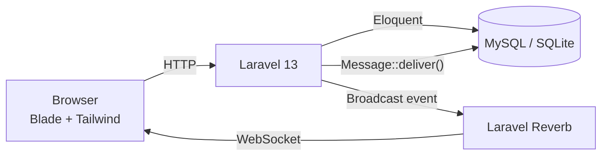
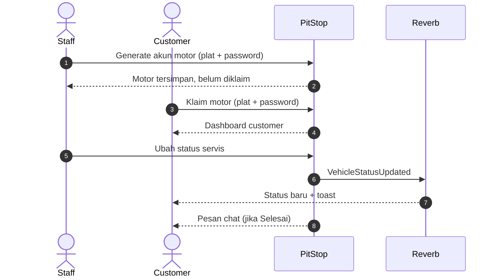

<div align="center">


# PitStop

**Sistem informasi bengkel yang menghubungkan pemilik bengkel dan customer dalam satu alur terpadu.**

Dari generate akun motor, klaim kepemilikan, pantau status servis, sampai chat real-time.

[](https://www.php.net/)
[](https://laravel.com/)
[](https://reverb.laravel.com/)
[](https://tailwindcss.com/)
[](https://pestphp.com/)
[](#lisensi)

[Fitur](#fitur-utama) · [Arsitektur](#arsitektur) · [Instalasi](#instalasi) · [Penggunaan](#penggunaan) · [Realtime](#notifikasi-real-time-reverb) · [Testing](#testing)

</div>

---

## Daftar Isi

- [Sekilas](#sekilas)
- [Fitur Utama](#fitur-utama)
- [Arsitektur](#arsitektur)
- [Teknologi](#teknologi)
- [Kebutuhan Sistem](#kebutuhan-sistem)
- [Instalasi](#instalasi)
  - [Quick Start](#quick-start)
  - [Konfigurasi Environment](#konfigurasi-environment)
  - [Menjalankan Aplikasi](#menjalankan-aplikasi)
- [Penggunaan](#penggunaan)
  - [Akun Bawaan](#akun-bawaan)
  - [Alur Admin / Owner](#alur-admin--owner)
  - [Alur Customer](#alur-customer)
  - [Route Penting](#route-penting)
- [Notifikasi Real-Time (Reverb)](#notifikasi-real-time-reverb)
  - [Cara Mengetes Reverb](#cara-mengetes-reverb)
- [Struktur Proyek](#struktur-proyek)
- [Catatan Arsitektur](#catatan-arsitektur)
- [Testing](#testing)
- [Deploy ke Production](#deploy-ke-production)
- [Troubleshooting](#troubleshooting)
- [Kontribusi](#kontribusi)
- [Lisensi](#lisensi)

---

## Sekilas

PitStop menyelesaikan satu masalah sederhana: **customer tidak perlu bolak-balik
telepon bengkel untuk tahu motornya sudah selesai atau belum.**

| Peran | Yang bisa dilakukan |
| ----- | ------------------- |
| **Customer** | Daftar, klaim motor, lihat status servis, ubah data motor, chat bengkel |
| **Admin / Owner** | Daftarkan motor, kelola semua motor, ubah status, kirim pengingat, balas chat |

Tiga status servis: `Belum Servis` → `Sedang Servis` → `Selesai`.

Saat status berubah atau pesan masuk, dashboard customer langsung diperbarui lewat
WebSocket (toast + bunyi). Kalau Reverb mati, status tetap sinkron lewat polling
15 detik — aplikasi tidak bergantung pada satu jalur notifikasi.

---

## Fitur Utama

### Autentikasi & Role

- Register, login (memakai **username**), logout.
- Tiga role: `customer`, `admin`, `owner` pada kolom `role` di tabel `users`.
- Satu sumber kebenaran untuk cek role: `User::isStaff()` (admin + owner) dipakai
  oleh middleware, form request, policy, dan controller.
- Middleware `owner` untuk area bengkel dan `claimed` untuk customer yang belum
  menautkan motor.

### Generate Akun & Klaim Motor

- Admin/owner mendaftarkan motor di `/owner/vehicles/create`: nama, jenis, plat,
  password plat, dan status awal.
- Customer mengklaim motor di `/claim` dengan plat + password dari bengkel.
- Password plat disimpan **hash** dan satu motor tidak bisa diklaim dua akun.

### Dashboard Customer

- Detail kendaraan real dari database: plat, pemilik, jenis, nama, status.
- Tombol **Ubah Data Kendaraan** membuka halaman edit yang sama dengan admin.
  Customer hanya boleh mengubah plat + nama; jenis dan status tetap wewenang
  bengkel (dijaga `VehiclePolicy` + `UpdateVehicleRequest`).
- Status ter-update real-time lewat channel `vehicle.{id}`, dengan fallback
  polling `GET /customer/status` tiap 15 detik.

### Dashboard Admin / Owner

- Tabel semua motor: plat, pemilik (atau "belum diklaim"), badge status.
- Kartu statistik dihitung sekali jalan dari koleksi yang sama (`countBy`),
  bukan tiga query terpisah.
- Tombol **Ubah** per baris membuka halaman edit dengan data asli dan error
  validasi di halaman yang sama.
- Tombol **lonceng** mengirim pengingat ke customer sebagai pesan chat.
- Mengubah status menjadi **Selesai** otomatis mengirim pesan ke pemilik motor.

### Chat Real-Time & Privat

- `Message::deliver()` adalah **satu-satunya** jalur pembuatan + broadcast pesan,
  dipakai oleh chat, pengingat, dan notifikasi selesai servis.
- `Message::scopeVisibleTo()` membatasi isi halaman chat: customer hanya melihat
  percakapan yang melibatkan dirinya, staff melihat semua thread.
- Broadcast menuju **private channel milik penerima** (`App.Models.User.{id}`),
  sehingga user lain tidak bisa menguping.
- Pesan tetap tersimpan walau server Reverb sedang mati.

---

## Arsitektur



Alur bisnis utama:



### Peta Event

| Event | Channel | Dipicu saat | Diterima oleh |
| ----- | ------- | ----------- | ------------- |
| `MessageSent` | `App.Models.User.{id}` (private) | Pesan chat terkirim | Dashboard + halaman chat penerima |
| `VehicleStatusUpdated` | `vehicle.{id}` (publik) | Status motor berubah | Dashboard customer |

Keduanya memakai `ShouldBroadcastNow`, jadi **tidak butuh queue worker**.
Otorisasi channel privat ada di `routes/channels.php` dan didaftarkan lewat
`withBroadcasting(..., ['middleware' => ['web']])` di `bootstrap/app.php`.

---

## Teknologi

| Lapisan | Teknologi |
| ------- | --------- |
| Backend | PHP 8.3+ (teruji di 8.5), Laravel 13 |
| Database | MySQL (dev: `sts_kel1`), SQLite in-memory untuk test |
| Real-time | Laravel Reverb + Laravel Echo + pusher-js |
| Frontend | Blade, Tailwind CSS 4, Vite 8 |
| Testing | Pest 5 (PHPUnit di baliknya) |
| Tooling | Laravel Pint, Laravel Boost, Laravel Pail |
| Environment | Laragon (Apache/MySQL) atau `php artisan serve` |

---

## Kebutuhan Sistem

- PHP **>= 8.3** dengan ekstensi standar Laravel
- Composer 2
- Node.js 20+ & NPM
- MySQL 8 / MariaDB (atau SQLite untuk eksperimen cepat)

---

## Instalasi

### Quick Start

```bash
# 1. Dependency
composer install
npm install

# 2. Environment
cp .env.example .env
php artisan key:generate

# 3. Database + akun bawaan
php artisan migrate --seed

# 4. Frontend
npm run build        # produksi
# atau: npm run dev  # development

# 5. Server
php artisan serve --port=8000
```

Buka `http://localhost:8000`, lalu jalankan Reverb di terminal terpisah:

```bash
php artisan reverb:start --host=127.0.0.1 --port=8080
```

### Konfigurasi Environment

Untuk MySQL di Laragon, sesuaikan bagian berikut di `.env`:

```dotenv
DB_CONNECTION=mysql
DB_HOST=127.0.0.1
DB_PORT=3306
DB_DATABASE=sts_kel1
DB_USERNAME=root
DB_PASSWORD=
```

Konfigurasi real-time:

```dotenv
BROADCAST_CONNECTION=reverb

REVERB_APP_ID=local
REVERB_APP_KEY=...
REVERB_APP_SECRET=...
REVERB_HOST=127.0.0.1
REVERB_PORT=8080
REVERB_SCHEME=http

VITE_REVERB_APP_KEY="${REVERB_APP_KEY}"
VITE_REVERB_HOST="${REVERB_HOST}"
VITE_REVERB_PORT="${REVERB_PORT}"
VITE_REVERB_SCHEME="${REVERB_SCHEME}"
```

> **Penting:** jalankan Reverb dengan `--host=127.0.0.1`, bukan `localhost`.
> Kalau memakai `localhost`, Reverb gagal start dengan pesan
> `Given URI "tcp://localhost:8080" does not contain a valid host IP`.
>
> Kalau `REVERB_*` diubah, sesuaikan juga `VITE_REVERB_*` lalu `npm run build` ulang.

### Menjalankan Aplikasi

Pilih salah satu:

```bash
# Satu proses untuk server + queue + Vite
composer run dev

# Atau manual
php artisan serve --port=8000
php artisan reverb:start --host=127.0.0.1 --port=8080
npm run dev
```

---

## Penggunaan

### Akun Bawaan

Dibuat otomatis oleh `php artisan migrate --seed`:

| Username | Password | Role | Kegunaan |
| -------- | -------- | ---- | -------- |
| `admin` | `admin` | admin | Kelola motor, reminder, chat |
| `ajung` | `bengkel123` | owner | Sama seperti admin |

> Ganti password bawaan setelah login pertama di production.

### Alur Admin / Owner

1. Login sebagai `admin` / `ajung` → otomatis diarahkan ke `/owner/dashboard`.
2. Buka **Generate Akun** (`/owner/vehicles/create`), isi data motor, lalu simpan.
   Berikan plat + password ke customer (offline).
3. Klik **Ubah** pada baris tabel untuk membuka halaman edit.
4. Klik ikon **lonceng** untuk mengirim pengingat ke customer pemilik motor.
5. Buka **Chat** untuk membalas customer.
6. Ubah status menjadi **Selesai** → customer otomatis menerima pesan dan toast.

### Alur Customer

1. **Daftar** akun → **login** → otomatis diarahkan ke `/claim`.
2. Masukkan plat + password dari bengkel → masuk ke `/customer`.
3. Lihat status servis, ubah data kendaraan, atau buka chat bengkel.
4. Toast + bunyi muncul saat status berubah atau ada pesan baru.

### Route Penting

| Method | URL | Nama | Akses |
| ------ | --- | ---- | ----- |
| GET | `/` | — | publik |
| GET/POST | `/login` | `login`, `login.attempt` | guest |
| GET/POST | `/register` | `register`, `register.store` | guest |
| GET | `/dashboard` | `dashboard` | auth, redirect per role |
| GET/POST | `/claim` | `vehicle.claim`, `vehicle.claim.store` | auth |
| GET | `/customer` | `customer.dashboard` | auth + claimed |
| GET | `/customer/status` | `customer.status` | auth + claimed |
| GET/PUT | `/vehicles/{vehicle}/edit` | `vehicles.edit`, `vehicles.update` | staff / pemilik motor |
| GET/POST | `/chat` | `chat`, `chat.send` | auth |
| GET | `/owner/dashboard` | `owner.dashboard` | staff |
| GET | `/owner/vehicles` | `owner.vehicles.index` | staff |
| GET/POST | `/owner/vehicles/create` | `owner.vehicles.create`, `owner.vehicles.store` | staff |
| POST | `/owner/vehicles/{vehicle}/remind` | `owner.vehicles.remind` | staff |

---

## Notifikasi Real-Time (Reverb)

- Broadcast driver: `reverb` (`BROADCAST_CONNECTION=reverb`).
- `MessageSent` dikirim ke private channel penerima; isi chat tidak bisa diintip
  user lain.
- `VehicleStatusUpdated` dikirim ke channel publik `vehicle.{id}` dan membawa
  payload status yang sama dengan endpoint polling.
- Kedua event memakai `ShouldBroadcastNow` sehingga tidak butuh queue worker.
- Tanpa Reverb, dashboard customer tetap ter-update lewat polling 15 detik.

### Cara Mengetes Reverb

**A. Lewat dua browser (end-to-end)**

1. Pastikan tiga proses jalan: `php artisan serve`, `php artisan reverb:start`,
   dan Vite (`npm run dev` atau hasil `npm run build`).
2. Browser biasa: login `admin` / `admin` → `/owner/dashboard`.
3. Incognito: login sebagai customer yang sudah klaim motor → `/customer`.
4. Di jendela admin, klik ikon **lonceng** pada baris motor customer tersebut.
5. Dalam < 1 detik jendela customer harus menampilkan toast + bunyi.
   Kalau tidak, cek Console browser (F12) untuk error WebSocket.

**B. Lewat Tinker (membuktikan event keluar dari Laravel)**

```bash
php artisan tinker
```

```php
// Kirim event status ke dashboard customer (ganti id kalau perlu)
broadcast(new App\Events\VehicleStatusUpdated(App\Models\Vehicle::find(1)));

// Kirim pesan chat ke user id 1
$to = App\Models\User::find(1);
$from = App\Models\User::where('role', 'owner')->first();
App\Models\Message::deliver($from, $to, 'Tes realtime dari tinker');
```

**C. Lewat WebSocket langsung (opsional)**

Buka `ws://127.0.0.1:8080/app/local?protocol=7&client=js&version=8.4.0&flash=false`,
kirim `{"event":"pusher:subscribe","data":{"channel":"vehicle.1"}}`, lalu jalankan
perintah Tinker di atas. Payload `status.updated` harus masuk ke socket tersebut.

> Debug Reverb: log server ada di terminal `reverb:start`. Kalau muncul
> `Failed to connect`, biasanya `VITE_REVERB_*` tidak cocok dengan `REVERB_*`
> atau frontend belum di-build ulang.

---

## Struktur Proyek

```text
app/
├── Events/                 MessageSent, VehicleStatusUpdated
├── Http/
│   ├── Controllers/        Auth, Dashboard, Vehicle, Claim, Chat
│   ├── Middleware/         EnsureOwner, EnsureVehicleClaimed
│   └── Requests/           Store/UpdateVehicle, ClaimVehicle, SendMessage
├── Models/                 User, Vehicle, Message
├── Policies/               VehiclePolicy
└── Providers/              AppServiceProvider

bootstrap/app.php           Routing, middleware alias, broadcasting

database/
├── factories/              UserFactory, VehicleFactory
├── migrations/             users, vehicles, messages, cache, jobs
└── seeders/                DatabaseSeeder (akun admin & owner)

resources/
├── css/app.css             Tailwind entry
├── js/                     app.js, echo.js
└── views/                  Blade: auth, dashboard, chat, owner, customer

routes/
├── web.php                 Semua route aplikasi
├── channels.php            Otorisasi private channel
└── console.php

tests/Feature/              42 test (auth, workshop, chat, reminder, realtime)
```

---

## Catatan Arsitektur

Beberapa keputusan sengaja dibuat supaya logika tidak tersebar:

| Keputusan | Alasan |
| --------- | ------ |
| `Message::deliver()` sebagai satu-satunya jalur kirim pesan | Chat, reminder, dan notifikasi selesai konsisten dan sama-sama tahan Reverb mati |
| `Vehicle::statusPayload()` | Payload polling dan event real-time tidak pernah beda bentuk |
| `User::landingRouteName()` + `User::shouldClaimVehicle()` | Redirect per role tidak ditulis ulang di controller dan middleware |
| `Vehicle::notifyOwner()` | Semua pesan ke pemilik motor menangani kasus "belum diklaim" dengan cara sama |
| `VehicleValidationRules` trait | Aturan validasi store & update tidak duplikat |
| Satu halaman edit + satu endpoint update | Dulu ada `KendaraanController` dan route kendaraan ganda; sekarang staff dan customer memakai jalur yang sama, dibedakan policy |

---

## Testing

```bash
# Seluruh suite (Pest, SQLite in-memory)
php artisan test --compact

# Satu file / satu test
php artisan test --compact --filter="private user channel"
```

Cakupan saat ini: **42 test, 131 assertion**.

- Autentikasi: register, login, validasi, proteksi role.
- Alur workshop: generate akun, klaim, ubah status, tabel owner.
- Edit kendaraan: staff vs customer, policy, status tidak bisa diubah customer.
- Chat: isolasi percakapan, kirim pesan, validasi, channel privat + auth.
- Reminder: staff/admin boleh, customer ditolak, motor belum diklaim.
- Pesan otomatis saat motor selesai.
- Event broadcast: nama channel + payload `MessageSent`.
- Ketahanan saat Reverb mati: chat dan update status tetap tersimpan.
- Rate limit login, klaim motor, chat, dan reminder.
- Customer tidak bisa mengubah password klaim atau mengirim pesan ke customer lain.

Format kode PHP mengikuti Laravel Pint:

```bash
vendor/bin/pint --dirty --format agent
```

---

## Deploy ke Production

Checklist minimum sebelum go-live:

```bash
composer install --no-dev --optimize-autoloader
npm ci
npm run build

php artisan migrate --force
php artisan config:cache
php artisan route:cache
php artisan view:cache
```

- `.env`: set `APP_ENV=production`, `APP_DEBUG=false`, dan `APP_URL` ke domain asli.
- Wajib HTTPS, lalu set `SESSION_SECURE_COOKIE=true`. Kalau di belakang reverse
  proxy, atur trusted proxies di `bootstrap/app.php`.
- Jalankan `php artisan reverb:start --host=0.0.0.0 --port=8080` sebagai service
  (supervisor/systemd) dan buka port-nya. Ini satu-satunya proses long-running
  yang dibutuhkan.
- Queue worker tidak wajib: kedua event memakai `ShouldBroadcastNow`.
- Backup database dan `storage/` secara berkala. Password klaim sudah di-hash dan
  disembunyikan dari serialisasi.
- Rate limit sudah aktif di login, register, klaim, chat, dan reminder
  (lihat `routes/web.php`). Sesuaikan angkanya kalau trafik bengkel tinggi.

---

## Troubleshooting

| Gejala | Penyebab umum & solusi |
| ------ | ---------------------- |
| Halaman blank / `ViteException` | Frontend belum di-build → `npm run build` (atau `npm run dev`) |
| Chat/notif tidak real-time | Reverb belum jalan → `php artisan reverb:start --host=127.0.0.1 --port=8080`; build ulang setelah ubah `VITE_REVERB_*` |
| `Echo` undefined di Console | Halaman tidak memuat `@vite(['resources/js/app.js'])` atau build belum jalan |
| `403` saat `Echo.private` | `/broadcasting/auth` belum terdaftar → pastikan `withBroadcasting(...)` ada di `bootstrap/app.php`; cek user sudah login |
| `Given URI "tcp://localhost:8080" does not contain a valid host IP` | Jalankan Reverb dengan `--host=127.0.0.1` |
| Event tidak terkirim padahal Reverb jalan | `BROADCAST_CONNECTION=null`/`log` di `.env`, atau event bukan `ShouldBroadcast` |
| `403 Hanya pemilik bengkel` | Sedang login sebagai customer → logout, login `admin`/`ajung` |
| `Unknown column 'username'` / `vehicle_type` | Migrasi kepotong → `php artisan migrate` |
| Login gagal setelah fresh migrate | Data kehapus → `php artisan migrate --seed` |
| Perubahan view tidak muncul | `php artisan view:clear` |
| `No application key` | `.env` hilang → copy dari `.env.example` + `php artisan key:generate` |

---

## Kontribusi

1. Fork repo dan buat branch fitur: `git checkout -b fitur/nama-fitur`.
2. Ikuti konvensi yang sudah ada (Pest untuk test, Pint untuk format).
3. Pastikan `php artisan test --compact` dan `vendor/bin/pint --dirty` bersih.
4. Buka pull request dengan deskripsi perubahan yang jelas.

---

## Lisensi

MIT — bebas dipakai, dimodifikasi, dan dikontribusikan.
